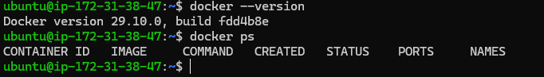
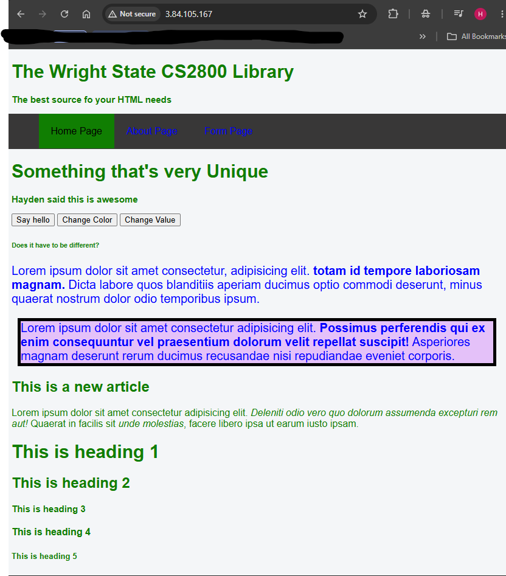
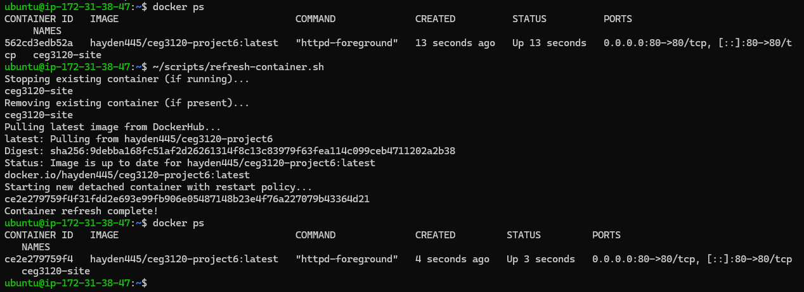

## Part 1 - Script a Refresh

### EC2 Instance Details

To host the containerized web application reliably, an AWS EC2 instance was provisioned with a static Elastic IP so that automated deployment webhooks always have a consistent target address.

* **AMI Information:** Ubuntu Server 24.04 LTS (64-bit x86) — `ami-0c30b7300f5fb34cd` 
* **Instance Type:** `t2.medium` (2 vCPUs, 4 GB RAM)
* **Volume Size:** 30 GiB `gp3` root EBS volume
* **Elastic IP:** `3.84.105.167`

#### Security Group Configuration

| Type | Protocol | Port Range | Source | Purpose |
| :--- | :--- | :--- | :--- | :--- |
| SSH | TCP | `22` | `130.108.0.0/16` | Administrative SSH access from Wright State University campus network |
| HTTP | TCP | `80` | `0.0.0.0/0` | Public web traffic to the hosted container application |
| Custom TCP | TCP | `9000` | `0.0.0.0/0` | Manual testing of the `webhook` listener endpoint and allows incoming webhook payloads from GitHub|

#### Security Group Justification

The inbound rules follow the principle of least privilege. SSH access (`22`) is restricted exclusively to my home IP address and the Wright State University CIDR block (`130.108.0.0/16`) rather than `0.0.0.0/0` to prevent unauthorized brute-force login attempts. HTTP traffic (`80`) is open to `0.0.0.0/0` so any user can view the live website in a browser. Finally, port `9000` (used by `adnanh/webhook`) is locked down to GitHub's official `hooks` IP ranges—retrieved from the GitHub Meta API—alongside my home IP for local testing, blocking unsolicited external traffic from hitting the deployment listener.


*This screenshot confirms the `t2.medium` EC2 instance is running with an assigned Elastic IP and shows the configured Security Group inbound rules for ports 22, 80, and 9000.*

---

### Docker Setup on EC2 Instance

#### Installing Docker & Dependencies

On Ubuntu Server, Docker Engine and its required CLI/container runtime dependencies (`docker-ce`, `docker-ce-cli`, `containerd.io`, `docker-buildx-plugin`, and `docker-compose-plugin`) were installed using Docker's official convenience script after updating the system package index:

```bash
sudo apt update && sudo apt upgrade -y
curl -fsSL [https://get.docker.com](https://get.docker.com) -o get-docker.sh
sudo sh get-docker.sh
```

To allow the default ubuntu user to execute Docker commands without prepending sudo, the user was added to the docker group and the group membership was refreshed:

```
sudo usermod -aG docker ubuntu
newgrp docker
```

#### Confirming Docker Installation
Docker installation and daemon permissions were verified by checking the installed version and listing active containers without sudo:

```
docker --version
docker ps
```

*This screenshot proves Docker is installed and that the ubuntu user can run `docker ps` without requiring sudo privileges.*

### Testing on EC2 Instance
#### Pulling and Running the Container Image
Before automating deployments, the application image built in Project 6 was manually pulled from DockerHub and launched on the EC2 instance:

```
docker pull hayden445/ceg3120-project6:latest
docker run -d --name ceg3120-site -p 80:80 hayden445/ceg3120-project6:latest
```

#### `-it` vs. `-d` Flag Comparison
* `-it` **(Interactive + Pseudo-TTY):** Attaches the terminal's standard input and output directly to the container process. This is useful during initial debugging when inspecting live console output or running an interactive shell inside the container, but closing the SSH session or pressing `Ctrl+C`terminates the process.

* `-d` **(Detached Mode):**  Runs the container in the background as a daemon and returns control of the terminal prompt immediately.

* **Recommendation:** Once testing is complete, `-d` **(detached mode)** is strongly recommended because a production web server must continue running persistently in the background after the administrator disconnects from SSH.

#### Verifying the Web Application
After starting the container, `docker ps` was used to confirm the container status (Up) and port mapping (`0.0.0.0:80->80/tcp`). Navigating to `http://3.84.105.167` in a web browser verified that the web application rendered properly.



*This screenshot shows web browser loading the site at the EC2 instance's public Elastic IP.*

### Scripting Container Application Refresh
#### Bash Script Overview
To automate container updates whenever a new image is pushed to DockerHub, a Bash script was created at `~/scripts/refresh-container.sh` on the EC2 instance and saved in this repository at `deployment/refresh-container.sh`.

When executed, the script performs four sequential actions:

1. **Stop existing container:** Runs `docker stop ceg3120-site 2>/dev/null || true` to gracefully halt the active container without throwing a fatal error if no container is currently running.

2. **Remove old container:** Runs `docker rm ceg3120-site 2>/dev/null || true` to free up the container name and port binding.

3. **Pull updated image:** Runs `docker pull hayden445/ceg3120-project6:latest` to download the newest `latest` image tag from DockerHub.

4. **Launch updated container:** Runs 
`docker run -d --name ceg3120-site --restart unless-stopped -p 80:80 hayden445/ceg3120-project6:latest`
to start the updated container in detached mode with a restart policy that automatically brings the site back online if the Docker service or EC2 instance reboots.

### Testing & Verifying the Refresh Script
The script was made executable (`chmod +x ~/scripts/refresh-container.sh`) and verified in two stages:

1. Container Replacement Test: `docker ps` was run before and after executing `./refresh-container.sh` to confirm the old container was replaced by a brand-new `CONTAINER ID` running the `latest` image.

2. Reboot Persistence Test: The restart policy was inspected with `docker inspect --format '{{.HostConfig.RestartPolicy.Name}}' ceg3120-site` (returning `unless-stopped`), followed by `sudo reboot`. After reconnecting, `uptime` and `docker ps` confirmed the container restarted automatically on boot.



*This screenshot shows `docker ps` before and after running `refresh-container.sh`, proving the script stops the old container and launches a new container ID with the latest image.*


*This screenshot confirms the container's restart policy is set to `unless-stopped` and shows `uptime` alongside `docker ps` after a system reboot, proving the container restarts automatically.*

### Resources
* [Docker Post-Installation Steps for Linux](https://docs.docker.com/engine/install/linux-postinstall/): Used for adding the ubuntu user to the docker group to run Docker commands without sudo and configuring container restart policies (--restart unless-stopped).
* [Docker run CLI Reference](https://docs.docker.com/reference/cli/docker/container/run/): Referenced for comparing detached (-d) versus interactive (-it) container execution flags and port publishing (-p).